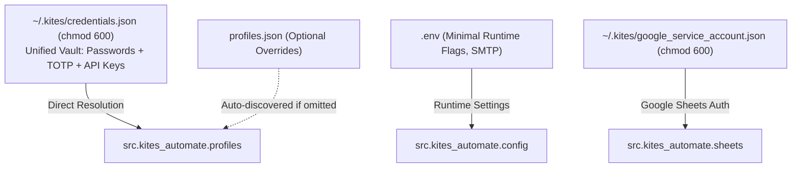

# Configuration and Secrets Specification

This document defines the strict, defense-in-depth architecture used by `kites-automate` for managing secrets, credentials, and runtime configurations.

---

## Security Philosophy & Isolation

`kites-automate` interacts with live trading accounts and automated broker logins. Because this application runs unattended on a self-hosted server (`phantomhive`), secrets are separated by operational lifecycle and risk domain:

- **Zero-Log Policy**: Passwords, TOTP secrets, API secrets, and access tokens are never logged or exposed in stdout, stderr, or log files.
- **Out-of-Repository Storage**: Sensitive user credentials and session tokens reside in `~/.kites/`, outside of version control.
- **Repository Isolation**: Git strictly ignores `.env`, `credentials.json`, `profiles.json`, and all local state files via hardened `.gitignore` and enforced pre-commit hooks.

---

## Configuration Layers



---

### Layer 1: Broker Login Credentials (`~/.kites/credentials.json`)

### Layer 1: Unified Credentials Vault (`~/.kites/credentials.json`)

Used by both automated headless authentication and the Kite Connect SDK. Co-locates all account credentials (login, TOTP, and API keys) outside of version control.

- **Path**: `~/.kites/credentials.json`
- **Permissions**: `chmod 700 ~/.kites && chmod 600 ~/.kites/credentials.json`
- **Template**: [`docs/credentials_template.json`](file:///Users/phantomhive/Desktop/Atul/kites-automate/docs/credentials_template.json)

```json
{
  "account1": {
    "username": "your_account1_zerodha_user_id",
    "password": "your_account1_zerodha_password",
    "totp_secret": "your_account1_totp_secret_from_authenticator_app",
    "api_key": "your_account1_kite_api_key",
    "api_secret": "your_account1_kite_api_secret"
  },
  "account2": {
    "username": "your_account2_zerodha_user_id",
    "password": "your_account2_zerodha_password",
    "totp_secret": "your_account2_totp_secret_from_authenticator_app",
    "api_key": "your_account2_kite_api_key",
    "api_secret": "your_account2_kite_api_secret"
  }
}
```

---

### Layer 2: API Keys & Application Secrets (`.env`)

Used by the Kite Connect SDK and email notification handlers.

- **Path**: `.env` (at repository root)
- **Permissions**: `chmod 600 .env`
- **Template**: [`.env.example`](file:///Users/phantomhive/Desktop/Atul/kites-automate/.env.example)

```bash
# Zerodha Kite Connect API Keys & Secrets
account1_api_key=your_account1_api_key_here
account1_api_secret=your_account1_api_secret_here

account2_api_key=your_account2_api_key_here
account2_api_secret=your_account2_api_secret_here

# Timezone
TIMEZONE=Asia/Kolkata

# Optional: Email Notifications (leave blank to skip)
SMTP_HOST=
SMTP_PORT=587
SMTP_USERNAME=
SMTP_PASSWORD=
EMAIL_FROM=
EMAIL_TO=
EMAIL_USE_TLS=true
```

---

### Layer 3: Account Profiles & Sheet Mapping (`profiles.json`)

Maps account names to environment variable keys and Google Sheet settings.

- **Path**: `profiles.json` (at repository root or `~/.kites/profiles.json`)
- **Template**: [`profiles.json.example`](file:///Users/phantomhive/Desktop/Atul/kites-automate/profiles.json.example)

```json
{
  "profiles": [
    {
      "profile_name": "Account1",
      "api_key_env": "account1_api_key",
      "api_secret_env": "account1_api_secret",
      "token_file": "account1_access_token.txt",
      "description": "Primary trading portfolio",
      "exception_list": []
    },
    {
      "profile_name": "Account2",
      "api_key_env": "account2_api_key",
      "api_secret_env": "account2_api_secret",
      "token_file": "account2_access_token.txt",
      "description": "Secondary investment portfolio",
      "exception_list": []
    }
  ],
  "settings": {
    "spreadsheet_name": "Portfolio",
    "summary_sheet_name": "Summary",
    "default_update_mode": "smart"
  }
}
```

---

### Layer 4: Google Cloud Service Account

Grants write access to the target Google Spreadsheet.

- **Candidate Search Paths**:
  1. `GOOGLE_APPLICATION_CREDENTIALS` environment variable
  2. `~/.kites/google_service_account.json` (chmod 600)
  3. `~/.kites/sheets_credentials.json` (chmod 600)
  4. `./credentials.json` (repository root, git-ignored)
- **Scopes Required**:
  - `https://spreadsheets.google.com/feeds`
  - `https://www.googleapis.com/auth/drive`
- **Spreadsheet Sharing**: Share the destination Google Sheet with the `client_email` found inside the service account key with **Editor** role.

---

### Layer 5: Code-Level Defaults (`src/kites_automate/config.py`)

Eliminated legacy `config/defaults.yaml`. All non-sensitive fallbacks (timezone, schedule, retry policies) are strictly typed using Pydantic models with sensible defaults (`Asia/Kolkata`, smart formatting, etc.) and auto-discovers configured accounts from `~/.kites/credentials.json` or `profiles.json`.

---

## Log Redaction & Audit Safeguards

All logging calls pass through `SecretRedactingFilter` in `src/kites_automate/logging_setup.py`:
- Sensitive fields (`password=`, `api_key=`, `api_secret=`, `totp_secret=`, `access_token=`, `Bearer ...`) are automatically transformed into `[REDACTED]`.
- API keys and tokens are only logged with their string length (e.g. `len=32`).
